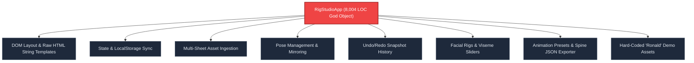
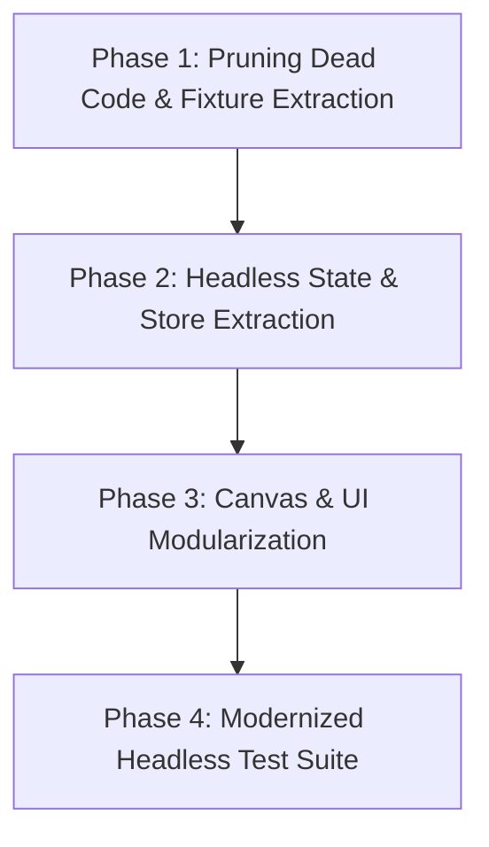

# Character Rig Studio: Codebase Architecture & Testing Analysis

**Repository:** `PointAndClickQuestEngine` (`WebQuestEngine`)  
**Target Domain:** `src/rig-studio/` & `tests/unit/rig-studio/`  
**Date of Audit:** October 2026  
**Total Production Code:** ~21,100 LOC TypeScript  
**Total Test Code:** ~3,300 LOC TypeScript across 12 test suites (118 tests)  

---

## Executive Summary

The **Character Rig Studio** (`src/rig-studio/`) is a comprehensive, browser-based 2D skeletal rigging, automatic spritesheet slicing, facial animation, and keyframe animation suite. It serves as an authoring companion for the 2D Point & Click Adventure Engine and integrates with external runtimes via the Spine 2D JSON format.

The codebase displays **exceptional algorithmic craftsmanship** in core areas: analytical two-bone Inverse Kinematics (IK), Forward Kinematics (FK) angular propagation, Marching Squares vector contour tracing, and typed JSON interop.

However, the architecture suffers from **extreme class bloat ("God Object" anti-pattern)**, **heavy coupling between DOM UI and core state**, and **~2,245 LOC of dead or orphaned code**. In testing, while mathematical leaf modules have fast, elegant unit tests, higher-level integration tests suffer from heavy DOM dependencies, recurring canvas context mock warnings, over 70 `as any` casts to poke at private variables, and complete test blind spots across major features (such as Undo/Redo, Pose management, and Spine export).

---

## 1. Codebase Inventory & Metrics

### Production Files (`src/rig-studio/`)

| File / Component | LOC | Purpose & Key Responsibilities | Architectural Health |
| :--- | :--- | :--- | :--- |
| [RigStudioApp.ts](file:///home/itaibh/Projects/PointAndClickQuestEngine/src/rig-studio/RigStudioApp.ts) | **8,004** | Master orchestrator: DOM layout, sidebars, modals, slicing, rigging, facial rigs, animation tracks, undo/redo, localStorage, Spine export, demo characters. | ⚠️ **Critical God Object** |
| [RigStudioCanvas.ts](file:///home/itaibh/Projects/PointAndClickQuestEngine/src/rig-studio/rigging/RigStudioCanvas.ts) | **3,295** | 2D Canvas viewport: bone & envelope rendering, artwork drawing, complex facial rendering (eyes/mouths/visemes), on-canvas transform & facial placement gizmos, part alignment. | ⚠️ **Severe Monolith** |
| [KeyframeTimeline.ts](file:///home/itaibh/Projects/PointAndClickQuestEngine/src/rig-studio/timeline/KeyframeTimeline.ts) | **3,070** | Keyframe timeline: canvas ruler, DOM track rendering, element tracks, diamond markers, drag-to-move, multi-selection, playback loops, FK/IK toggle. | ⚠️ **High Coupling** |
| [VectorElementSlicer.ts](file:///home/itaibh/Projects/PointAndClickQuestEngine/src/rig-studio/slicer/VectorElementSlicer.ts) | **1,264** | Interactive sprite sheet editor: magic click, polygon vertex editing, element splitting, thumbnails, auto-tracing. | 🟡 Medium (Canvas & DOM mixed) |
| [AnatomicalRig.ts](file:///home/itaibh/Projects/PointAndClickQuestEngine/src/rig-studio/rigging/AnatomicalRig.ts) | **1,174** | Pure mathematical core: 2-bone analytical IK solver, FK tree rotation, envelope math, mirroring, Spine bone conversion. | 🟢 **Excellent (Pure Leaf)** |
| [FacialSetupWizard.ts](file:///home/itaibh/Projects/PointAndClickQuestEngine/src/rig-studio/dialogs/FacialSetupWizard.ts) | **770** | Modal dialogs for setting up procedural, sprite-swap, and cavity-sandwich eye & mouth rigs. | 🟡 Fair (Self-contained DOM dialog) |
| [BoneCanvasEditor.ts](file:///home/itaibh/Projects/PointAndClickQuestEngine/src/rig-studio/rigging/BoneCanvasEditor.ts) | **782** | Legacy bone editor canvas based on Spine bones. | 🔴 **Dead Code (Unused anywhere)** |
| [PoseRigManager.ts](file:///home/itaibh/Projects/PointAndClickQuestEngine/src/rig-studio/rigging/PoseRigManager.ts) | **704** | Spine-based pose manager for 4-directional presets. | 🔴 **Dead Code (Only used by dead editor)** |
| [types.ts](file:///home/itaibh/Projects/PointAndClickQuestEngine/src/rig-studio/types.ts) | **625** | Strongly-typed interfaces for bones, vector elements, sheets, facial rigs, Spine JSON, and iframe messages. | 🟢 **Excellent** |
| [PolygonGeometry.ts](file:///home/itaibh/Projects/PointAndClickQuestEngine/src/rig-studio/slicer/PolygonGeometry.ts) | **334** | Computational geometry: polygon area, centroid, RDP simplification, bounds. | 🟢 **Excellent (Pure Math)** |
| [MarchingSquares.ts](file:///home/itaibh/Projects/PointAndClickQuestEngine/src/rig-studio/slicer/MarchingSquares.ts) | **241** | 2D pixel grid contour tracing algorithm. | 🟢 **Excellent (Pure Algorithm)** |
| [InteractiveSandbox.ts](file:///home/itaibh/Projects/PointAndClickQuestEngine/src/rig-studio/preview/InteractiveSandbox.ts) | **318** | Interactive sandbox with click-to-walk. | 🔴 **Dead Code (Unreferenced)** |
| [PersistentPreviewPlayer.ts](file:///home/itaibh/Projects/PointAndClickQuestEngine/src/rig-studio/preview/PersistentPreviewPlayer.ts) | **193** | Preview animation player. | 🔴 **Dead Code (Unreferenced)** |
| [MiddleDragScroller.ts](file:///home/itaibh/Projects/PointAndClickQuestEngine/src/rig-studio/utils/MiddleDragScroller.ts) | **248** | Middle mouse click pan scroller utility. | 🔴 **Orphaned (Tested, but not attached)** |
| [RigStudioBridge.ts](file:///home/itaibh/Projects/PointAndClickQuestEngine/src/rig-studio/RigStudioBridge.ts) | **78** | Typed postMessage bridge communicating with host editor iframe. | 🟢 **Good (Needs listener cleanup)** |
| [main.ts](file:///home/itaibh/Projects/PointAndClickQuestEngine/src/rig-studio/main.ts) | **9** | Entry point for standalone HTML page. | 🟢 Good |
| [rig-studio.css](file:///home/itaibh/Projects/PointAndClickQuestEngine/src/rig-studio/styles/rig-studio.css) | **2,294** | Comprehensive CSS design tokens and theme styling. | 🟢 Good |

---

## 2. What's Good in Code Structure

### 1. Mathematical Rigor & Pure Functional Core
- **Analytical 2-Bone IK Solver** ([`solveTwoBoneIK`](file:///home/itaibh/Projects/PointAndClickQuestEngine/src/rig-studio/rigging/AnatomicalRig.ts#L177)): Fast, closed-form trigonometric solver for human limbs (knees and elbows). Handles hyperextension, bending directions, and singularity prevention without iteration.
- **Forward Kinematics Hierarchy** ([`poseJointFK`](file:///home/itaibh/Projects/PointAndClickQuestEngine/src/rig-studio/rigging/AnatomicalRig.ts#L688)): Robust recursive angular rotation and coordinate propagation down anatomical parent-child trees.
- **Headless Algorithmic Slicing** ([`MarchingSquares.ts`](file:///home/itaibh/Projects/PointAndClickQuestEngine/src/rig-studio/slicer/MarchingSquares.ts) & [`PolygonGeometry.ts`](file:///home/itaibh/Projects/PointAndClickQuestEngine/src/rig-studio/slicer/PolygonGeometry.ts)): Completely headless polygon simplification, centroid calculation, and contour extraction. These modules have zero DOM dependencies and execute in milliseconds.

### 2. Comprehensive, Strongly-Typed Domain Model ([`types.ts`](file:///home/itaibh/Projects/PointAndClickQuestEngine/src/rig-studio/types.ts))
- Every concept in the rig studio is defined by explicit TypeScript interfaces:
  - `AnatomicalJointId`, `AnatomicalBoneDef`, `BonePartAttachment`
  - `FacialRigConfig`, `EyeInstanceConfig`, `MouthInstanceConfig`, `VisemePreset`
  - `SpineDocument`, `SpineBoneData`, `SpineSkinData`, `SpineAnimationTrack`
  - `StudioHostMessage`, `StudioIframeMessage`
- Standardized origin conventions: Ground-level origin `(0, 0)` between feet with standardized height references (~380px reference height).

### 3. Decoupled Host-to-Iframe Bridge ([`RigStudioBridge.ts`](file:///home/itaibh/Projects/PointAndClickQuestEngine/src/rig-studio/RigStudioBridge.ts))
- Communication between the main game editor and the embedded Rig Studio is mediated through a typed protocol (`STUDIO_INIT`, `STUDIO_SAVE`, `STUDIO_DIRTY_STATE`, `STUDIO_READY`).
- Allows the Rig Studio to run identically in standalone development mode (`npm run dev:rig-studio`) and embedded within the primary editor iframe.

### 4. Rich Feature Set Aligned with UX Principles
- Follows the goals outlined in [`REQUIREMENTS.md`](file:///home/itaibh/Projects/PointAndClickQuestEngine/src/rig-studio/REQUIREMENTS.md): direct manipulation on canvas, multi-view directional symmetry (front, back, left, right), customizable layer stacking orders, N-instance facial feature support (alien/creature faces), and automatic alignment tools.

---

## 3. What Requires Improvement in Code Structure

### 1. The 8,000-Line "God Object" ([`RigStudioApp.ts`](file:///home/itaibh/Projects/PointAndClickQuestEngine/src/rig-studio/RigStudioApp.ts))
`RigStudioApp.ts` has accumulated over 120 methods and 8,004 lines of code. It violates the **Single Responsibility Principle** by conflating at least 8 distinct domains:
1. **DOM Layout & Templating**: Generates thousands of lines of HTML strings via inline template literals (`renderLeftSidebar`, `renderRightSidebar`, `renderFaceTabContent`, `renderAnimationsTabContent`, etc.).
2. **State Storage & Mutation**: Direct mutator for character name, active view, active sheet, active mode, facial rig, animations, and parts library.
3. **Resizer & Workspace Management**: Custom mouse drag logic for resizing left/right sidebars and bottom timeline height.
4. **Spritesheet & Asset Management**: Multi-sheet uploading, file readers, thumbnail caching, and image loading.
5. **Pose & View Management**: Pose duplication, mirroring, renaming, limb swapping, and active view switching.
6. **Facial Rigging Business Logic**: Setting common eye/mouth modes, synchronizing multi-instance face configs, viseme presets.
7. **Animation Authoring & Spine Conversion**: Timeline synchronization, walk/idle cycle generation, keyframe evaluation, Spine JSON track conversion.
8. **Undo/Redo History Engine**: Snapshot creation, undo/redo stacks, and state restoration.



### 2. Canvas Monolith ([`RigStudioCanvas.ts`](file:///home/itaibh/Projects/PointAndClickQuestEngine/src/rig-studio/rigging/RigStudioCanvas.ts) - 3,295 LOC)
`RigStudioCanvas` attempts to do everything inside a single HTML Canvas controller:
- **Canvas Viewport Transformations**: Pan, zoom, smooth camera pan animations (`animatePanTo`), and coordinate conversion (`screenToWorld`).
- **WYSIWYG Transformation Gizmos**: Hit-testing and interactive dragging for 8 transform handles (`body`, `rotate`, `pivot`, `tl`, `tr`, `bl`, `br`).
- **Interactive Facial Gizmo**: Center placement, rotation, and dragging of facial features.
- **Complex Rendering Passes**: Drawing bones, capsule envelopes, pins, character artwork, sclera clipping windows, eyelids, procedural lips, cavity sandwiches, and teeth.
- **Part Alignment Tools**: Snapping pivot to joint, centering on bone, 90-degree rotations, horizontal/vertical flips.

### 3. High Coupling in Timeline ([`KeyframeTimeline.ts`](file:///home/itaibh/Projects/PointAndClickQuestEngine/src/rig-studio/timeline/KeyframeTimeline.ts) - 3,070 LOC)
`KeyframeTimeline` mixes animation data interpolation and timekeeping with direct DOM rendering of ruler ticks, diamond markers, element group tracks, bone property subtracks, multi-selection drag-selection boxes, and `requestAnimationFrame` playback loops.

### 4. Over 2,245 LOC of Dead or Orphaned Code
Several files exist in `src/rig-studio/` that are either superseded or completely disconnected from the rest of the application:
1. [`BoneCanvasEditor.ts`](file:///home/itaibh/Projects/PointAndClickQuestEngine/src/rig-studio/rigging/BoneCanvasEditor.ts) (782 LOC): Never imported or instantiated anywhere in `src/`.
2. [`PoseRigManager.ts`](file:///home/itaibh/Projects/PointAndClickQuestEngine/src/rig-studio/rigging/PoseRigManager.ts) (704 LOC): Only used by `BoneCanvasEditor.ts` and its own isolated test. The real app uses `AnatomicalRig.ts`.
3. [`InteractiveSandbox.ts`](file:///home/itaibh/Projects/PointAndClickQuestEngine/src/rig-studio/preview/InteractiveSandbox.ts) (318 LOC) & [`PersistentPreviewPlayer.ts`](file:///home/itaibh/Projects/PointAndClickQuestEngine/src/rig-studio/preview/PersistentPreviewPlayer.ts) (193 LOC): Dead preview prototypes.
4. [`MiddleDragScroller.ts`](file:///home/itaibh/Projects/PointAndClickQuestEngine/src/rig-studio/utils/MiddleDragScroller.ts) (248 LOC): Fully implemented and tested, but never imported or attached in `RigStudioApp`.

> [!WARNING]
> Dead code increases maintenance overhead, misleads developers about actual application architecture, and adds cognitive load during refactoring.

### 5. Hard-Coded Demo Characters Bleeding into Production Code
Methods like `assembleAllRonaldParts()`, `loadRonaldDemoParts()`, `loadRonaldPreMarkedElementsInSlicer()`, and the default sheet ID `'sheet_ronald'` are hardcoded directly into [`RigStudioApp.ts`](file:///home/itaibh/Projects/PointAndClickQuestEngine/src/rig-studio/RigStudioApp.ts#L2740).
- Demo character logic should be loaded as an external project asset or JSON template fixture, completely independent of the core application runtime.

### 6. Event Listener Cleanup & Memory Management
- [`RigStudioBridge.ts`](file:///home/itaibh/Projects/PointAndClickQuestEngine/src/rig-studio/RigStudioBridge.ts#L12) calls `window.addEventListener('message', ...)` in its constructor without providing a `destroy()` or unbind method.
- In [`RigStudioApp.ts`](file:///home/itaibh/Projects/PointAndClickQuestEngine/src/rig-studio/RigStudioApp.ts), sidebars and tabs are repeatedly reconstructed via `innerHTML = ...` followed by `addEventListener`. Without disciplined unsubscription or event delegation, replaced DOM nodes can trigger memory leaks or orphaned listener traps.

---

## 4. Testing Suite Analysis

### Existing Test Inventory (`tests/unit/rig-studio/`)

| Test File | Tests | LOC | What It Covers | Quality Assessment |
| :--- | :--- | :--- | :--- | :--- |
| [AnatomicalRig.test.ts](file:///home/itaibh/Projects/PointAndClickQuestEngine/tests/unit/rig-studio/AnatomicalRig.test.ts) | 26 | 503 | 2-bone IK solver, FK rotation, bone preservation constraints, symmetry mirroring, Spine bone conversion. | 🟢 **Top Tier**: Pure math, fast, zero DOM, excellent coverage. |
| [BoneLayerOrdering.test.ts](file:///home/itaibh/Projects/PointAndClickQuestEngine/tests/unit/rig-studio/BoneLayerOrdering.test.ts) | 8 | 123 | Default bone layer ordering, move up/down/top/bottom, layer mirroring. | 🟢 **Good**: Clean logic verification. |
| [MarchingSquares.test.ts](file:///home/itaibh/Projects/PointAndClickQuestEngine/tests/unit/rig-studio/MarchingSquares.test.ts) | 6 | 101 | Pixel contour extraction, disjoint islands, boundary conditions. | 🟢 **Good**: Pure algorithm tests. |
| [PolygonGeometry.test.ts](file:///home/itaibh/Projects/PointAndClickQuestEngine/tests/unit/rig-studio/PolygonGeometry.test.ts) | 7 | 76 | Area, centroid, RDP simplification, bounding boxes. | 🟢 **Good**: Pure geometric tests. |
| [RigStudioBridge.test.ts](file:///home/itaibh/Projects/PointAndClickQuestEngine/tests/unit/rig-studio/RigStudioBridge.test.ts) | 6 | 78 | PostMessage protocol (INIT, SAVE, READY, DIRTY). | 🟢 **Good**: Clean message contracts. |
| [MiddleDragScroller.test.ts](file:///home/itaibh/Projects/PointAndClickQuestEngine/tests/unit/rig-studio/MiddleDragScroller.test.ts) | 7 | 146 | Mouse drag scrolling, wheel interaction, cursor states. | 🟡 Tests an orphaned utility not used in app. |
| [PoseRigManager.test.ts](file:///home/itaibh/Projects/PointAndClickQuestEngine/tests/unit/rig-studio/PoseRigManager.test.ts) | 11 | 319 | Multi-view bone directional presets on legacy class. | 🔴 Tests legacy dead code. |
| [PartAlignment.test.ts](file:///home/itaibh/Projects/PointAndClickQuestEngine/tests/unit/rig-studio/PartAlignment.test.ts) | 8 | 294 | Pivot snapping, centering on bone, 90-degree rotations, flips. | 🟡 Moderate: Couples directly to `RigStudioCanvas`. |
| [VectorElementSlicer.test.ts](file:///home/itaibh/Projects/PointAndClickQuestEngine/tests/unit/rig-studio/VectorElementSlicer.test.ts) | 11 | 194 | Node editing, element splitting, thumbnails, layer reordering. | 🟡 Moderate: Relies on DOM and Canvas mocks. |
| [KeyframeTimeline.test.ts](file:///home/itaibh/Projects/PointAndClickQuestEngine/tests/unit/rig-studio/KeyframeTimeline.test.ts) | 17 | 695 | Duration, zoom, markers, selection, copy/paste, closeCycle. | 🟡 High DOM coupling, uses `(timeline as any)`. |
| [FacialControlsAndWizards.test.ts](file:///home/itaibh/Projects/PointAndClickQuestEngine/tests/unit/rig-studio/FacialControlsAndWizards.test.ts) | 12 | 536 | Wizard DOM popups, facial keyframing, sliders, N-instance faces. | ⚠️ Brittle: 30+ `(app as any)` casts, DOM mocks. |
| [RigLoadingAndSync.test.ts](file:///home/itaibh/Projects/PointAndClickQuestEngine/tests/unit/rig-studio/RigLoadingAndSync.test.ts) | 5 | 230 | Loading project data, sync between tabs, workspace resizers. | ⚠️ Brittle: Heavy `(app as any)` inspection. |

---

## 5. What Requires Improvement in Testing

### 1. Fragile DOM Coupling & Ubiquitous `(app as any)` Casts
Because `RigStudioApp` has no separate headless store or state container, testing basic business logic requires instantiating the entire UI shell in jsdom. Consequently, tests cannot inspect state cleanly through public APIs and resort to **over 70 instances of `as any`**:
```typescript
// Example from tests/unit/rig-studio/FacialControlsAndWizards.test.ts
expect((app as any).facialRig.eyeInstances[3].name).toBe('Alien Forehead Eye');
expect((app as any).views.front.facialRig.offsetX).toBe(25);
(app as any).facialRig.offsetX = -18;
```
If a private field is renamed during refactoring, TypeScript cannot detect the breakage at compile time.

### 2. Missing Canvas 2D Backend & Noisy Test Logs
Whenever tests instantiate `RigStudioApp`, `RigStudioCanvas`, or `KeyframeTimeline`, the headless `jsdom` environment fails to provide a real 2D canvas context. This causes dozens of warnings in every test run:
```
Not implemented: HTMLCanvasElement's getContext() method: without installing the canvas npm package
```
There is no mock Canvas adapter or headless rendering abstraction, causing tests to either trigger warnings or risk failing if code attempts to read pixel data from an unmocked context.

### 3. Critical Feature Blind Spots (Zero Test Coverage)

Despite having 118 unit tests, several core subsystems of the Rig Studio have **0% test coverage**:

| Subsystem / Feature | Production Methods | Current Coverage | Risk Level |
| :--- | :--- | :---: | :---: |
| **Undo / Redo History** | `recordHistory()`, `undo()`, `redo()`, `restoreHistoryState()` | **0%** | 🔴 High: Regressions in state restoration can corrupt projects |
| **Pose Lifecycle Management** | `createPose()`, `deletePose()`, `duplicatePose()`, `duplicateAndMirrorPose()`, `promptRenamePose()` | **0%** | 🔴 High: Core user workflow for creating 4-way/8-way character rigs |
| **Spine 2D Document Export** | `buildSpineDocument()`, `exportSpineJson()`, `convertStudioAnimationsToSpineTracks()` | **0%** | 🔴 High: Primary pipeline for exporting characters into game engines |
| **Animation Clip Operations** | `createAnimation()`, `deleteAnimation()`, `renameAnimation()`, `duplicateAnimation()`, `generatePresetCycle()` | **0%** | 🔴 High: Animation timeline clip management |
| **Multi-Sheet Management** | `addImageSheetFromFile()`, `deleteImageSheet()`, `applyAllSheetsToRig()`, `switchImageSheet()` | **0%** | 🟡 Medium: Slicing assets across multiple spritesheets |
| **Canvas Gizmo Hit-Testing** | `hitTestPartGizmo()`, `getPartAtPoint()`, `getBoneAtPoint()`, `getPartTransformInfo()` | **0%** | 🟡 Medium: Canvas direct manipulation accuracy |

### 4. Tests Dedicated to Dead Code
- `tests/unit/rig-studio/PoseRigManager.test.ts` (319 LOC) exercises `PoseRigManager`, which is not integrated into `RigStudioApp`.
- `tests/unit/rig-studio/MiddleDragScroller.test.ts` (146 LOC) tests `MiddleDragScroller`, which is never used in the actual application.
- Over **465 LOC of tests** (~14% of the test suite) are maintaining code that provides zero value to end users.

---

## 6. Comprehensive Refactoring Roadmap

To transform `src/rig-studio/` into a maintainable, extensible, and thoroughly tested architecture, work should proceed in four structured phases:



### Phase 1: Pruning Dead Code & Fixture Extraction
1. **Remove Unused Legacy Files**: Delete `BoneCanvasEditor.ts`, `PoseRigManager.ts` (and its test), `InteractiveSandbox.ts`, and `PersistentPreviewPlayer.ts`.
2. **Integrate or Remove `MiddleDragScroller.ts`**: If middle-click dragging is intended for the canvas or slicer, attach it cleanly to `RigStudioCanvas` and `VectorElementSlicer`; otherwise, prune it.
3. **Externalize Demo Characters**: Extract the "Ronald" demo character and sample element definitions out of `RigStudioApp.ts` into a dedicated fixture file (`src/rig-studio/fixtures/ronaldDemoCharacter.ts` or JSON asset).

### Phase 2: Headless State & Store Extraction
1. **Create `RigStudioStore` (State Machine / Store)**:
   - Extract character state, views, active sheet, parts library, facial configurations, and animation clips from `RigStudioApp.ts` into a headless, observable store.
   - Implement pure state actions (`setJoint`, `attachPart`, `createPose`, `duplicateAndMirrorPose`, `setCommonEyeMode`, `createAnimation`).
2. **Extract `HistoryManager`**:
   - Move `recordHistory`, `undo`, `redo`, and snapshot generation into a dedicated, testable `HistoryManager<T>` class with fixed-depth stacks.
3. **Extract `SpineExporter`**:
   - Move `buildSpineDocument` and Spine format serialization into a dedicated service (`src/rig-studio/export/SpineExporter.ts`).

### Phase 3: Canvas & UI Modularization
1. **Modularize `RigStudioCanvas.ts`**:
   - Extract `CanvasGizmoController.ts`: handles hit testing, bounding box calculations, and transform handles (`translate`, `rotate`, `scale`, `pivot`).
   - Extract `FacialCanvasRenderer.ts`: handles facial features drawing (sclera window clipping, eyes, visemes, cavity sandwich, eyebrows).
   - Keep `RigStudioCanvas.ts` focused on main draw loops, coordinate matrices, and viewport rendering.
2. **Componentize `RigStudioApp.ts` UI Views**:
   - Break sidebars into modular view controllers (`BonesSidebarView`, `FacialSidebarView`, `PartsLibrarySidebarView`, `LayersSidebarView`, `AnimationsSidebarView`).
   - Replace monolithic `innerHTML` string concatenations with structured view components or templates.

### Phase 4: Modernized Headless Test Suite
1. **Migrate Tests to the Headless Store**:
   - Test pose duplication, facial mode synchronization, layer ordering, and animation clips directly against `RigStudioStore` without constructing a DOM tree or mock Canvas.
   - Eliminate all 70+ `as any` casts by querying typed store getters.
2. **Add Missing Subsystem Tests**:
   - Write comprehensive tests for `HistoryManager` (undo/redo stacks, boundary conditions, snapshot accuracy).
   - Write unit tests for `SpineExporter` verifying valid Spine 2D JSON generation.
   - Write unit tests for `CanvasGizmoController` verifying coordinate transformation math and handle hit-testing.
3. **Add Headless Canvas Mocking**:
   - Provide a lightweight mock for `CanvasRenderingContext2D` to eliminate Vitest console warnings.

---

## 7. Summary Scorecard

| Category | Rating | Summary |
| :--- | :---: | :--- |
| **Mathematical & Rigging Core** | **A+** | 2-bone analytical IK, Forward Kinematics, and polygon marching squares algorithms are clean, fast, and robust. |
| **Domain Type Safety (`types.ts`)** | **A** | Detailed, comprehensive TypeScript interfaces covering Spine 2D JSON and all rig components. |
| **Code Structure & Modularization** | **D** | Extreme God Object (`RigStudioApp` at 8,004 LOC) and monoliths (`RigStudioCanvas` at 3,295 LOC, `KeyframeTimeline` at 3,070 LOC). |
| **Code Cleanliness & Dead Code** | **C-** | ~2,245 LOC of dead or orphaned code; hardcoded demo character logic mixed into application core. |
| **Unit Test Coverage (Leaf Algorithms)** | **A** | Fast, headless unit tests with high coverage for IK/FK math, geometry, and marching squares. |
| **Unit Test Architecture (High-Level)** | **D+** | High DOM coupling, 70+ `as any` casts, canvas context warnings, and zero tests for Undo/Redo, Poses, or Spine export. |
